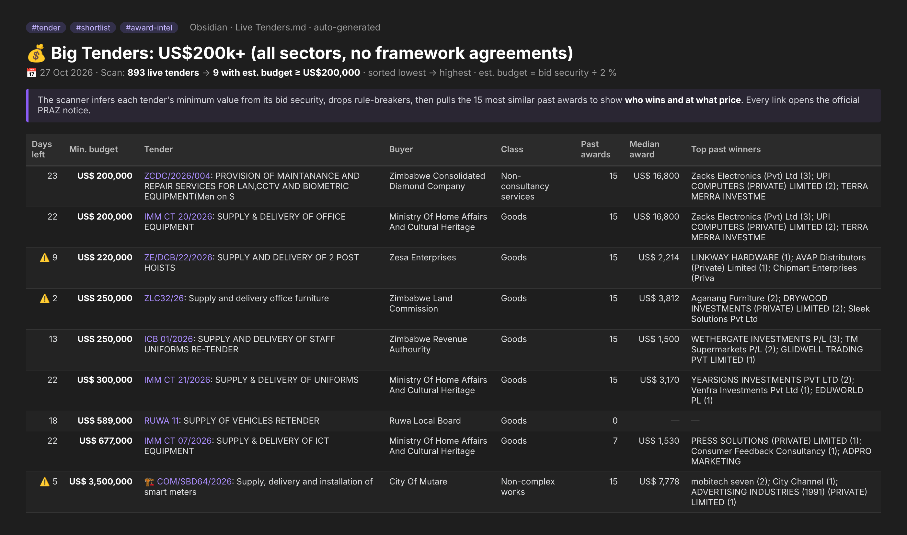
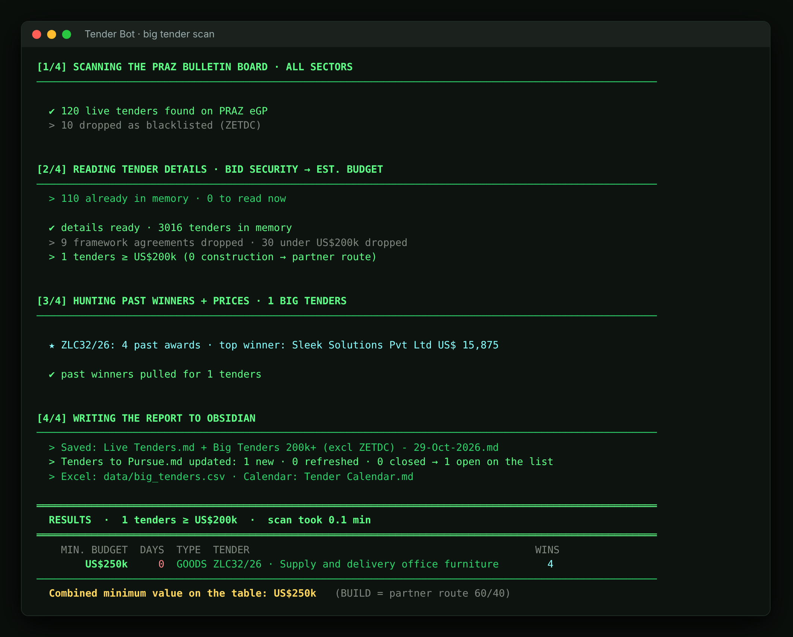
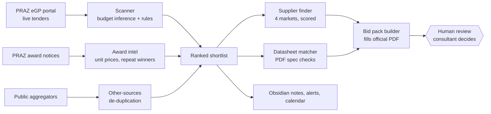

# Zimbabwe Tender Bot: AI Tender-Intelligence Agent

**A Python + LLM agent that turns Zimbabwe's 850+ live government tenders into a ranked shortlist, competitor price intelligence, supplier leads and a pre-filled bid pack.** It was built from a 19-year tender consultant's evaluation playbook.

> 🔒 **Case study only.** The source code, API keys, scraped data and client bid documents are private. This repo shows what the system does and how it was built. Code walkthrough available in interview.

**Built by:** Darrel Ruzande · Oct 2026 – present · Solo build, AI-assisted (Claude Code)

---

## The problem
Zimbabwe's public procurement portal (PRAZ eGP) lists hundreds of live tenders with **no contract values, no filter by size and no history of who won before**. A tender consultant has to:
1. open every notice to guess whether it's worth bidding on,
2. dig through old award notices by hand to find winning prices,
3. source suppliers across several countries,
4. collect manufacturer datasheets to prove every technical spec, which is the stage where most bidders get eliminated,
5. fill the official bid forms.

That's days of work per tender, and most of it is repetitive.

## What I built
| Stage | What the agent does | Result |
|---|---|---|
| **1 · Scan** | Crawls every live tender, reads each notice and **infers the budget from the bid security** (bid security ÷ 2 %). It then applies the consultant's rules: minimum value, no framework agreements, a buyer blacklist, and construction flagged for a partner route | **~850 tenders → a ranked shortlist in minutes** |
| **2 · Award intel** | Searches past award notices by line-item category. Computes median and range, **unit prices** and repeat winners | "What price actually wins" for any item |
| **3 · Other sources** | Reads public aggregator listings and de-duplicates them against the portal | Surfaces only the ~10 % the portal misses |
| **4 · Supplier finder** | Searches each spec line in 4 markets (Zimbabwe, South Africa, China/OEM, Dubai/India) via a search API. Scores leads on spec match, price signal, size fit and local presence | 60–230 ranked supplier leads per tender (so far) |
| **5 · Datasheet matcher** | Finds manufacturer datasheets, reads the PDFs and **checks every requirement against the datasheet text**. Matching is unit-aware (kVA/kW, MPa↔bar, ranges, dB at distance, IP and insulation codes) | A technical compliance matrix with page references |
| **6 · Bid pack** | Fills the official tender PDF in place and appends annexes: clarification questions, admin checklist, clause-by-clause compliance, price build-up | A review-ready mock bid |
| **7 · Ops** | Terminal menu, scheduled morning scan, phone push alerts, deadline calendar, Obsidian notes as the output layer | Runs daily with no babysitting |

## Screenshots
**The shortlist it writes to Obsidian.** A real scan of 893 live tenders cut to the 9 worth bidding on, each with similar past awards and winners:

**The terminal run.** Scan → read details and infer budgets → pull past winners → write the report (shown here as a short test run):

## Architecture

## Sample output (public PRAZ award data)
*The agent's answer to "what are software tenders in Zimbabwe actually worth?":*

> **49 software awards (2025–26): median US$5.6k · 75 % under US$23k · only 2 above US$200k.** Most of the money is licence resale (Sophos, ESET, Kaspersky, Sage). Custom builds are rare and small.

| Date | Buyer | Winner | Amount | Items |
|---|---|---|---|---|
| Jul 2025 | Procurement Regulatory Authority of Zimbabwe | Nextenders Africa | **US$290,534** | e-GP software maintenance and support |
| Jul 2025 | Standards Association of Zimbabwe | Lumac Technology | **US$248,600** | Sophos XGS firewall + ESET licences |
| Oct 2026 | Zimbabwe Energy Regulatory Authority | Kenac Computer Systems | **US$57,750** | IFRS 18 configuration in SAP |
| Sep 2025 | Judicial Service Commission | Soxfort Solutions | **US$46,250** | 25 × court recording software |
| Apr 2026 | Plumtree Town Council | Olimem Enterprises | **US$38,950** | Sage Evolution ERP upgrade |
| Jan 2026 | Hwange Local Board | Harare Institute of Technology | **US$28,000** | ERP software |

## Engineering highlights
- **Scraping a portal with no API:** replays form state for search, rate-limits politely, caches 2,000+ tender details and resumes interrupted full runs.
- **Turning noisy data into decisions:** infers budgets, flags outliers, and uses word-boundary classifiers to separate real matches from keyword noise ("cap" ≠ "capacitor", "suit" ≠ "suitable").
- **Spec-to-evidence matching:** a small rules engine that normalises numbers and units from tender text and PDF datasheets, so a requirement like `≥ 25 kW @ 0.8 pf` can be checked against a `33 kVA` datasheet.
- **LLM in the loop, safely:** research steps return structured JSON that's validated before use. The domain rules live in a playbook the agent reads before every assessment.
- **Guardrails by design:** the agent drafts and people decide. It never submits bids, pays fees or emails suppliers, and it never edits or invents datasheets, references or certificates.
- **Built to run on a normal laptop:** Windows batch menu, Task Scheduler for daily scans, phone alerts. No servers needed.

## Results so far
- Scans **~850 live tenders** and holds **2,000+ tender details** in its cache.
- **Generator tender (47 units):** full practice bid on the official forms, with a clarification list, a 21-line compliance matrix, a price build-up and a marking sheet for a tender consultant to score.
- **Workshop hoist tender:** the datasheet matcher found the closest compliant model (6 of 6 specs met vs 5 of 8 for the first candidate).
- **43-lot staff uniform tender:** 54 comparable past awards with unit prices, plus 227 supplier leads across 15 product families.

## Stack
Python · requests · BeautifulSoup · pypdf · reportlab · qpdf · python-docx · Brave Search API · Claude Code (agentic development + research) · Windows Task Scheduler · Obsidian (Markdown)

## What I learned
- Domain rules beat clever models: encoding the consultant's playbook mattered more than any single algorithm.
- Most of the work in data products is cleaning and verification. Every number in the output links back to its source notice.
- Design for human review: the agent's job is to make a good decision fast and easy, not to make it.

---
© 2026 Darrel Ruzande. All rights reserved. No source code is published in this repository.
